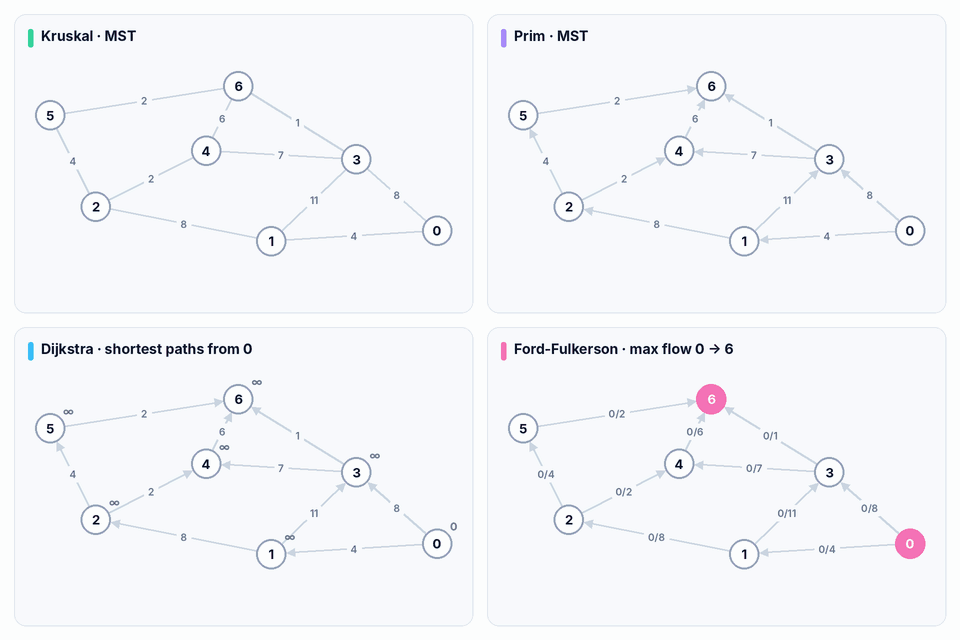
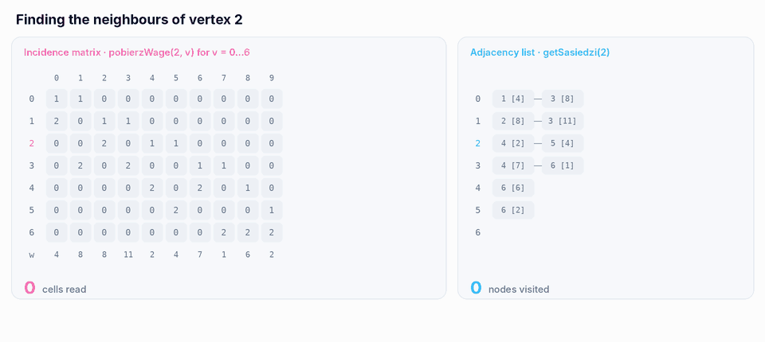
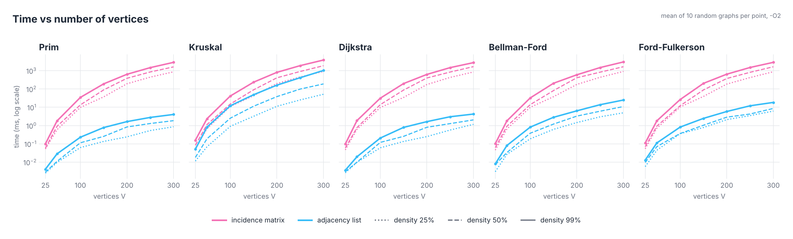
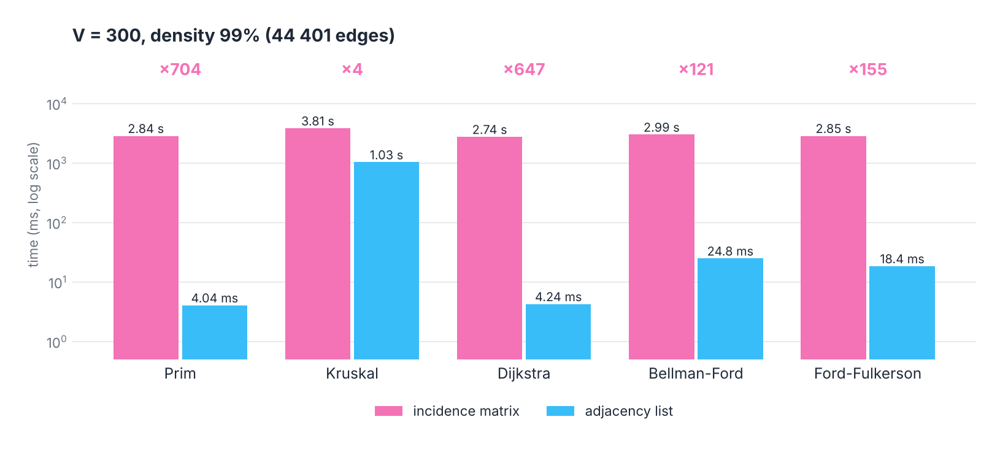

<p align="right">
  <a href="README.md"> <b>English</b></a>
  &nbsp;|&nbsp;
  <a href="README.pl.md"> Polski</a>
</p>

<a href="#see-it-in-action">
  <picture>
    <source media="(prefers-color-scheme: dark)" srcset="docs/banner-en-dark.svg" />
    <source media="(prefers-color-scheme: light)" srcset="docs/banner-en-light.svg" />
    
  </picture>
</a>

<p align="center">
  
  
  
  
  
</p>

<p align="center">
  <a href="#see-it-in-action"><b>Demo</b></a> &nbsp;·&nbsp;
  <a href="#the-algorithms"><b>Algorithms</b></a> &nbsp;·&nbsp;
  <a href="#two-representations"><b>Representations</b></a> &nbsp;·&nbsp;
  <a href="#results"><b>Results</b></a> &nbsp;·&nbsp;
  <a href="#correctness"><b>Correctness</b></a> &nbsp;·&nbsp;
  <a href="#getting-started"><b>Getting started</b></a>
</p>

**Graph Representations Benchmark** is the second project for the *Algorithms and Computational Complexity* course (*Algorytmy i Złożoność Obliczeniowa*) at Wrocław University of Science and Technology. It implements **Prim and Kruskal** (minimum spanning tree), **Dijkstra and Bellman-Ford** (shortest paths) and **Ford-Fulkerson** (maximum flow), each one twice: on an **incidence matrix** and on an **adjacency list**. The task was to measure how the running time depends on the graph size, its density and the representation.

All data structures are written by hand with dynamic allocation, as the assignment required: no `std::vector`, no `std::priority_queue`. A console menu loads a graph from a file or generates a random one, prints both representations and runs any algorithm on either of them. `tools/benchmark` repeats this automatically for 7 graph sizes and 3 densities.

## See it in action

<p align="center">
  <picture>
    <source media="(prefers-color-scheme: dark)" srcset="docs/en/algorithms-dark.gif" />
    <source media="(prefers-color-scheme: light)" srcset="docs/en/algorithms-light.gif" />
    
  </picture>
</p>

<p align="center"><sub>All four algorithms on <code>Dane/graf-2.txt</code>, step by step. Each replay follows the exact loop order and tie-breaking of the C++ code and was checked against the program's real output on all six test files. Notice the Prim panel: its tree weighs 28 while the minimum is 21, see <a href="#correctness">Correctness</a>.</sub></p>

## Highlights

<table>
  <tr>
    <td width="25%" align="center"><h3>5 × 2</h3><sub>algorithms, each on both<br/>representations</sub></td>
    <td width="25%" align="center"><h3>2 100</h3><sub>measurements on 210 random graphs,<br/>up to 300 vertices and 44 401 edges</sub></td>
    <td width="25%" align="center"><h3>×700</h3><sub>faster Prim and Dijkstra<br/>on the list than on the matrix</sub></td>
    <td width="25%" align="center"><h3>4 of 5</h3><sub>algorithms match networkx<br/>on every test graph</sub></td>
  </tr>
</table>

- **Everything by hand.** The incidence matrix, the linked adjacency list, the circular queue for BFS, a dynamic array template (`Tablica`) and a min-heap of edges (`KopiecKrawedzi`) are all implemented in the project.
- **Same data, two layouts.** Loading or generating a graph builds both representations from the same edge list, so every comparison runs on identical graphs.
- **Connected random graphs.** The generator first creates the directed cycle 0 → 1 → … → V−1 → 0 and only then adds random edges up to the requested density, so every vertex is reachable from every other.
- **Reproducible benchmark.** `tools/benchmark` calls the unchanged algorithms, reads the time each of them reports and averages it over a series of random graphs.

## The algorithms

| Problem | Algorithm | On the adjacency list | On the incidence matrix | How it is implemented |
|---|---|---|---|---|
| MST | Prim | O(V² + E) | O(V² · E) | linear search for the next vertex, no heap |
| MST | Kruskal | O(E² + V²) | O(V² · E + E²) | selection sort of the edges, components merged by relabelling |
| Shortest paths | Dijkstra | O(V² + E) | O(V² · E) | linear search for the closest unvisited vertex |
| Shortest paths | Bellman-Ford | O(V · E) | O(V² · E) | V−1 rounds of relaxing an edge array |
| Max flow | Ford-Fulkerson | O(V² · F′) | O(V² · E + V² · F′) | BFS for augmenting paths (Edmonds-Karp) on a V×V residual matrix |

*F′* is the number of augmenting paths. For MST the edges are treated as undirected, for shortest paths and maximum flow as directed, as in the assignment.

## Two representations

| | Incidence matrix (`MacierzIncydencji`) | Adjacency list (`ListaSasiedztwa`) |
|---|---|---|
| Layout | V rows × E columns; a column holds `1` at the start vertex and `2` at the end vertex of one edge, plus a row of weights | for every vertex a linked list of outgoing edges `(end, weight)` |
| Memory | V · E cells: 13 million for V = 300 at 99% | E nodes |
| "Is there an edge u → v?" | `pobierzWage(u, v)` scans the columns until it finds one: **O(E)** | walk the list of `u`: O(deg u) |

The matrix answers the question every algorithm asks most often, "which vertices can I reach from `u`?", only by calling `pobierzWage(u, v)` for every `v`, and each call scans the columns one by one:

<p align="center">
  <picture>
    <source media="(prefers-color-scheme: dark)" srcset="docs/en/lookup-dark.gif" />
    <source media="(prefers-color-scheme: light)" srcset="docs/en/lookup-light.gif" />
    
  </picture>
</p>

<p align="center"><sub>The exact reads made by <code>pobierzWage(2, v)</code> for v = 0…6 on <code>graf-2.txt</code>, next to the walk over <code>getSasiedzi(2)</code>. On a graph with 300 vertices and 44 401 edges the same question costs up to 13 million reads per vertex.</sub></p>

## Results

Each point is the mean time reported by the algorithm over 10 random graphs (`-O2`, one core, weights 1…100, flow from vertex 0 to V−1). Densities follow the assignment: 25%, 50% and 99% of the V(V−1)/2 possible edges.

<p align="center">
  <picture>
    <source media="(prefers-color-scheme: dark)" srcset="docs/en/scaling-dark.png" />
    <source media="(prefers-color-scheme: light)" srcset="docs/en/scaling-light.png" />
    
  </picture>
</p>

<p align="center">
  <picture>
    <source media="(prefers-color-scheme: dark)" srcset="docs/en/v300-dark.png" />
    <source media="(prefers-color-scheme: light)" srcset="docs/en/v300-light.png" />
    
  </picture>
</p>

| V = 300 | list, 25% | list, 99% | matrix, 25% | matrix, 99% |
|---|---|---|---|---|
| Prim | 0.86 ms | 4.04 ms | 864 ms | 2 843 ms |
| Kruskal | 51.3 ms | 1 027 ms | 904 ms | 3 814 ms |
| Dijkstra | 1.16 ms | 4.24 ms | 847 ms | 2 743 ms |
| Bellman-Ford | 4.97 ms | 24.8 ms | 908 ms | 2 992 ms |
| Ford-Fulkerson | 6.16 ms | 18.4 ms | 875 ms | 2 848 ms |

What the measurements show:

- **The representation matters more than the algorithm.** On the matrix all five algorithms take almost the same time (2.7 to 3.8 s at V = 300, 99%), because the run is dominated by V² calls of `pobierzWage`, each scanning up to E columns. On the list they spread over three orders of magnitude.
- **Prim and Dijkstra gain the most from the list:** 700 and 650 times faster. Both only need the neighbours of one vertex at a time, which the list gives directly.
- **Kruskal is the slowest on the list** (1 s at 99%) because it sorts the edges with selection sort, O(E²). A heap or merge sort would bring it to O(E log E); the project already has an edge heap (`KopiecKrawedzi`) that is not used yet.
- **Density scales the matrix almost linearly.** Going from 25% to 99% multiplies the number of edges by 4 and the matrix time by 3 to 4. On the list it hits Kruskal hardest: 20 times slower (51 ms to 1 027 ms), as expected from an O(E²) sort.
- **Bellman-Ford does V−1 full passes over all edges**, so on the list it is 4 to 6 times slower than Dijkstra; on positive weights both give the same distances.

## Correctness

Every algorithm was run through the real code on all six files in `Dane/` and on 72 random graphs (10, 30 and 60 vertices, three densities, 8 seeds each), and the results were compared with [networkx](https://networkx.org/):

| Algorithm | Result | Matrix = list |
|---|---|---|
| Kruskal | ✅ minimum spanning tree in every case | ✅ |
| Dijkstra | ✅ all distances correct | ✅ |
| Bellman-Ford | ✅ all distances correct | ✅ |
| Ford-Fulkerson | ✅ maximum flow correct | ✅ |
| Prim | ❌ tree heavier than the minimum in 5 of 6 files and in all 72 random graphs, on average by 79% | ✅ |

**Why Prim is off:** the minimum spanning tree is defined for an undirected graph, but both Prim implementations only follow edges **out of** the current vertex (`getSasiedzi(u)` on the list, `pobierzWage(u, v)` on the matrix). An edge stored as `3 → 6` can bring vertex 6 into the tree from 3, but not vertex 3 from 6. On `graf-1.txt` this makes Prim pick the edge `3 → 4` with weight 6 instead of `4 → 1` with weight 5. Kruskal looks at every edge regardless of direction, which is why it is always right. Looking at incoming edges as well (or storing each MST edge in both directions) would fix it; the timings above would barely change.

## Getting started

<p align="center">
  
</p>

**CLion:** open the folder and run `AiZO_Projekt_2`.

**Command line:**

```bash
cmake -S . -B build -DCMAKE_BUILD_TYPE=Release
cmake --build build
./build/AiZO_Projekt_2
```

| Menu | Action |
|---|---|
| 1 | load a graph from a file |
| 2 | generate a random graph: number of vertices, density in %, maximum weight |
| 3 | print the incidence matrix and the adjacency list |
| 4 | MST: Kruskal or Prim, then the representation |
| 5 | shortest paths: start vertex, then Dijkstra or Bellman-Ford and the representation |
| 6 | maximum flow: source, sink and the representation |

Every algorithm prints its own running time in microseconds before the result.

### Graph files

```
10 7        <- number of edges, number of vertices
0 1 4       <- start, end, weight
0 3 8
...
```

Vertices are numbered from 0. File names are resolved from the working directory; CLion runs the program in `cmake-build-debug`, so the test graphs are `../Dane/graf-1.txt` to `../Dane/graf-6.txt` (5 to 7 vertices, 6 to 11 edges). Messages in the program are in Polish.

### Running the benchmark

```bash
./build/benchmark                  # 10 graphs per point, up to 300 vertices
./build/benchmark 50 300 > results.csv
```

The output is CSV: `algorithm,representation,vertices,density,edges,mean_us,instances`. The default run takes about a quarter of an hour, almost all of it on the matrix.

## Project structure

```
.
├── main.cpp
├── Menu/                       # main menu and GrafManager (loading, generating, running algorithms)
├── Algorytmy/
│   ├── MST/                    # Prim, Kruskal
│   ├── NajkrotszaSciezka/      # Dijkstra, Bellman-Ford
│   └── MaksymalnyPrzeplyw/     # Ford-Fulkerson
├── Tablica/                    # MacierzIncydencji, ListaSasiedztwa, Tablica<T>, KopiecKrawedzi, Sciezka
├── Utils/                      # GeneratorGrafow, CzytnikGrafow
├── Dane/                       # test graphs graf-1 … graf-6
├── tools/benchmark.cpp         # automatic measurements, CSV output
├── docs/                       # README visuals (EN / PL, light / dark)
└── AZO_lista2.pdf              # the assignment
```

<details>
<summary><b>Notes on the code</b></summary>
<br/>

- Density is counted against V(V−1)/2 edges, and the generator never adds both `u → v` and `v → u`, so for the directed algorithms a 99% graph uses about half of all possible directed edges.
- `GeneratorGrafow::generuj` calls `srand(time(nullptr))` every time, so two graphs generated within the same second are identical. `tools/benchmark` uses the same scheme with its own seed per graph.
- The shortest path menu asks for an end vertex but prints the distances to all vertices; the paths themselves are not printed (`Sciezka` is implemented but not used yet).
- Loading or generating a new graph replaces the old one without freeing it.

</details>

---

<p align="center">
  <sub>Wrocław University of Science and Technology · Algorithms and Computational Complexity · Grzegorz Sienkiewicz</sub>
</p>
