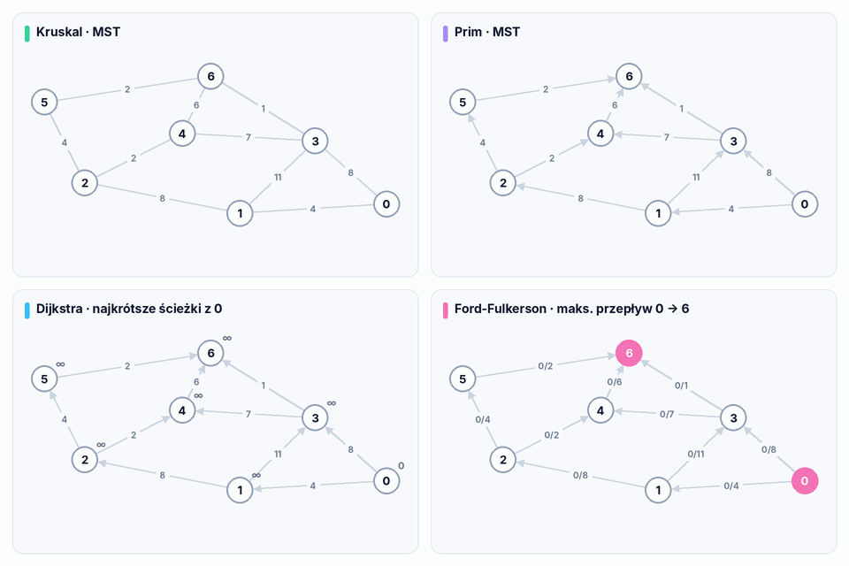
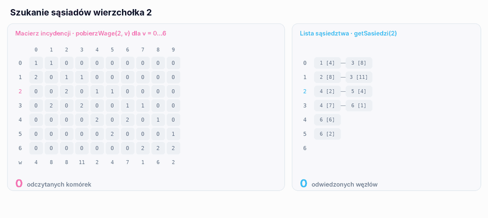
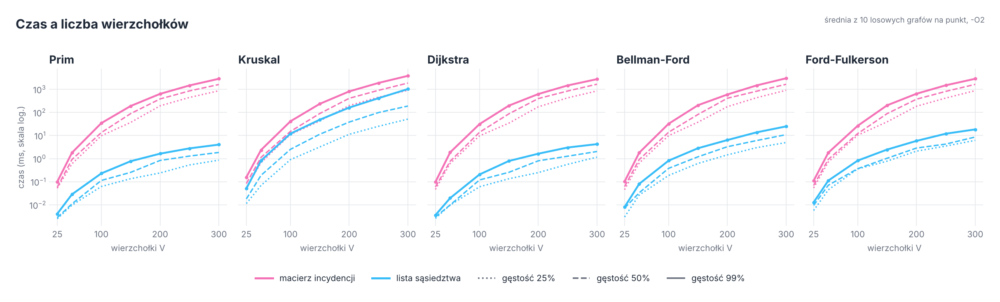
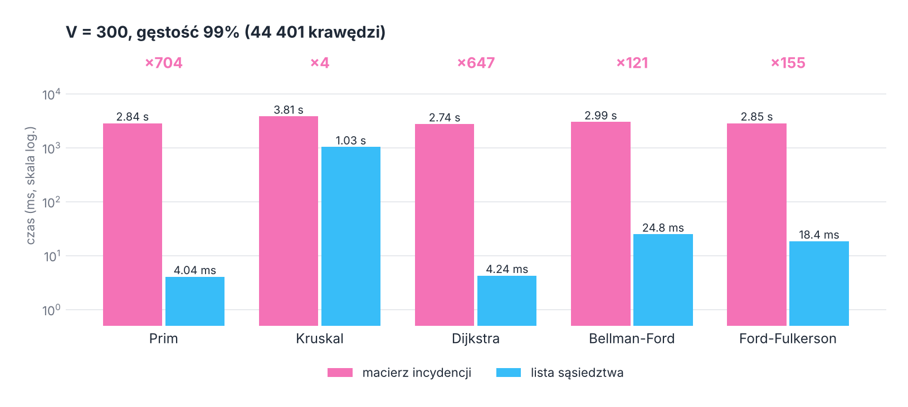

<p align="right">
  <a href="README.md"> English</a>
  &nbsp;|&nbsp;
  <a href="README.pl.md"> <b>Polski</b></a>
</p>

<a href="#zobacz-w-akcji">
  <picture>
    <source media="(prefers-color-scheme: dark)" srcset="docs/banner-pl-dark.svg" />
    <source media="(prefers-color-scheme: light)" srcset="docs/banner-pl-light.svg" />
    
  </picture>
</a>

<p align="center">
  
  
  
  
  
</p>

<p align="center">
  <a href="#zobacz-w-akcji"><b>Demo</b></a> &nbsp;·&nbsp;
  <a href="#algorytmy"><b>Algorytmy</b></a> &nbsp;·&nbsp;
  <a href="#dwie-reprezentacje"><b>Reprezentacje</b></a> &nbsp;·&nbsp;
  <a href="#wyniki"><b>Wyniki</b></a> &nbsp;·&nbsp;
  <a href="#poprawność"><b>Poprawność</b></a> &nbsp;·&nbsp;
  <a href="#uruchomienie"><b>Uruchomienie</b></a>
</p>

**Graph Representations Benchmark** to drugi projekt z przedmiotu *Algorytmy i Złożoność Obliczeniowa* na Politechnice Wrocławskiej. Zawiera algorytmy **Prima i Kruskala** (minimalne drzewo rozpinające), **Dijkstry i Bellmana-Forda** (najkrótsze ścieżki) oraz **Forda-Fulkersona** (maksymalny przepływ), każdy w dwóch wersjach: na **macierzy incydencji** i na **liście sąsiedztwa**. Celem było zmierzenie, jak czas działania zależy od rozmiaru grafu, jego gęstości i reprezentacji.

Wszystkie struktury danych są napisane ręcznie i alokowane dynamicznie, jak wymagało zadanie: bez `std::vector` i bez `std::priority_queue`. Menu w konsoli wczytuje graf z pliku albo generuje losowy, wyświetla obie reprezentacje i uruchamia dowolny algorytm na każdej z nich. `tools/benchmark` robi to samo automatycznie dla 7 rozmiarów grafu i 3 gęstości.

## Zobacz w akcji

<p align="center">
  <picture>
    <source media="(prefers-color-scheme: dark)" srcset="docs/pl/algorithms-dark.gif" />
    <source media="(prefers-color-scheme: light)" srcset="docs/pl/algorithms-light.gif" />
    
  </picture>
</p>

<p align="center"><sub>Cztery algorytmy na <code>Dane/graf-2.txt</code>, krok po kroku. Każde odtworzenie zachowuje dokładnie kolejność pętli i rozstrzyganie remisów z kodu C++ i zostało sprawdzone z prawdziwym wyjściem programu na wszystkich sześciu plikach testowych. Zwróć uwagę na panel Prima: jego drzewo waży 28, a minimum to 21, zobacz <a href="#poprawność">Poprawność</a>.</sub></p>

## Kluczowe wyniki

<table>
  <tr>
    <td width="25%" align="center"><h3>5 × 2</h3><sub>algorytmów, każdy na obu<br/>reprezentacjach</sub></td>
    <td width="25%" align="center"><h3>2 100</h3><sub>pomiarów na 210 losowych grafach,<br/>do 300 wierzchołków i 44 401 krawędzi</sub></td>
    <td width="25%" align="center"><h3>×700</h3><sub>szybszy Prim i Dijkstra<br/>na liście niż na macierzy</sub></td>
    <td width="25%" align="center"><h3>4 z 5</h3><sub>algorytmów zgodnych z networkx<br/>na każdym grafie testowym</sub></td>
  </tr>
</table>

- **Wszystko ręcznie.** Macierz incydencji, wiązana lista sąsiedztwa, kolejka cykliczna do BFS, szablon tablicy dynamicznej (`Tablica`) i kopiec krawędzi (`KopiecKrawedzi`) są zaimplementowane w projekcie.
- **Te same dane, dwa układy.** Wczytanie albo wygenerowanie grafu buduje obie reprezentacje z tej samej listy krawędzi, więc każde porównanie działa na identycznych grafach.
- **Spójne grafy losowe.** Generator najpierw tworzy skierowany cykl 0 → 1 → … → V−1 → 0, a dopiero potem dokłada losowe krawędzie do zadanej gęstości, więc z każdego wierzchołka da się dojść do każdego innego.
- **Powtarzalny benchmark.** `tools/benchmark` wywołuje niezmienione algorytmy, odczytuje czas, który każdy z nich sam wypisuje, i uśrednia go po serii losowych grafów.

## Algorytmy

| Problem | Algorytm | Na liście sąsiedztwa | Na macierzy incydencji | Implementacja |
|---|---|---|---|---|
| MST | Prim | O(V² + E) | O(V² · E) | liniowe szukanie kolejnego wierzchołka, bez kopca |
| MST | Kruskal | O(E² + V²) | O(V² · E + E²) | sortowanie krawędzi przez wybór, łączenie składowych przez przenumerowanie |
| Najkrótsze ścieżki | Dijkstra | O(V² + E) | O(V² · E) | liniowe szukanie najbliższego nieodwiedzonego wierzchołka |
| Najkrótsze ścieżki | Bellman-Ford | O(V · E) | O(V² · E) | V−1 rund relaksacji tablicy krawędzi |
| Maks. przepływ | Ford-Fulkerson | O(V² · F′) | O(V² · E + V² · F′) | BFS po ścieżki powiększające (Edmonds-Karp) na macierzy residualnej V×V |

*F′* to liczba ścieżek powiększających. Dla MST krawędzie są traktowane jako nieskierowane, a dla najkrótszych ścieżek i przepływu jako skierowane, zgodnie z treścią zadania.

## Dwie reprezentacje

| | Macierz incydencji (`MacierzIncydencji`) | Lista sąsiedztwa (`ListaSasiedztwa`) |
|---|---|---|
| Układ | V wierszy × E kolumn; kolumna ma `1` przy wierzchołku początkowym i `2` przy końcowym jednej krawędzi, do tego wiersz wag | dla każdego wierzchołka lista wiązana krawędzi wychodzących `(koniec, waga)` |
| Pamięć | V · E komórek: 13 mln dla V = 300 przy 99% | E węzłów |
| „Czy jest krawędź u → v?” | `pobierzWage(u, v)` przegląda kolumny, aż znajdzie pasującą: **O(E)** | przejście po liście `u`: O(deg u) |

Na pytanie, które algorytmy zadają najczęściej („do których wierzchołków dojdę z `u`?”), macierz odpowiada tylko przez wywołanie `pobierzWage(u, v)` dla każdego `v`, a każde wywołanie przegląda kolumny po kolei:

<p align="center">
  <picture>
    <source media="(prefers-color-scheme: dark)" srcset="docs/pl/lookup-dark.gif" />
    <source media="(prefers-color-scheme: light)" srcset="docs/pl/lookup-light.gif" />
    
  </picture>
</p>

<p align="center"><sub>Dokładne odczyty wykonywane przez <code>pobierzWage(2, v)</code> dla v = 0…6 na <code>graf-2.txt</code>, obok przejścia po <code>getSasiedzi(2)</code>. Na grafie z 300 wierzchołkami i 44 401 krawędziami to samo pytanie kosztuje do 13 mln odczytów na wierzchołek.</sub></p>

## Wyniki

Każdy punkt to średni czas wypisany przez algorytm dla 10 losowych grafów (`-O2`, jeden rdzeń, wagi 1…100, przepływ z wierzchołka 0 do V−1). Gęstości są zgodne z zadaniem: 25%, 50% i 99% z V(V−1)/2 możliwych krawędzi.

<p align="center">
  <picture>
    <source media="(prefers-color-scheme: dark)" srcset="docs/pl/scaling-dark.png" />
    <source media="(prefers-color-scheme: light)" srcset="docs/pl/scaling-light.png" />
    
  </picture>
</p>

<p align="center">
  <picture>
    <source media="(prefers-color-scheme: dark)" srcset="docs/pl/v300-dark.png" />
    <source media="(prefers-color-scheme: light)" srcset="docs/pl/v300-light.png" />
    
  </picture>
</p>

| V = 300 | lista, 25% | lista, 99% | macierz, 25% | macierz, 99% |
|---|---|---|---|---|
| Prim | 0,86 ms | 4,04 ms | 864 ms | 2 843 ms |
| Kruskal | 51,3 ms | 1 027 ms | 904 ms | 3 814 ms |
| Dijkstra | 1,16 ms | 4,24 ms | 847 ms | 2 743 ms |
| Bellman-Ford | 4,97 ms | 24,8 ms | 908 ms | 2 992 ms |
| Ford-Fulkerson | 6,16 ms | 18,4 ms | 875 ms | 2 848 ms |

Co pokazały pomiary:

- **Reprezentacja znaczy więcej niż algorytm.** Na macierzy wszystkie pięć algorytmów trwa prawie tyle samo (od 2,7 do 3,8 s przy V = 300 i 99%), bo czas zjada V² wywołań `pobierzWage`, a każde przegląda do E kolumn. Na liście ich czasy rozkładają się na trzy rzędy wielkości.
- **Najwięcej na liście zyskują Prim i Dijkstra:** są 700 i 650 razy szybsze. Oba potrzebują tylko sąsiadów jednego wierzchołka naraz, a lista podaje ich wprost.
- **Kruskal jest najwolniejszy na liście** (1 s przy 99%), bo sortuje krawędzie przez wybór, czyli w O(E²). Kopiec albo sortowanie przez scalanie dałyby O(E log E); projekt ma już kopiec krawędzi (`KopiecKrawedzi`), który nie jest jeszcze używany.
- **Gęstość skaluje macierz prawie liniowo.** Przejście z 25% na 99% zwiększa liczbę krawędzi 4 razy, a czas na macierzy 3 do 4 razy. Na liście najmocniej uderza w Kruskala: 20 razy wolniej (z 51 ms do 1 027 ms), jak można się spodziewać po sortowaniu O(E²).
- **Bellman-Ford robi V−1 pełnych przejść po wszystkich krawędziach**, więc na liście jest 4 do 6 razy wolniejszy niż Dijkstra; przy dodatnich wagach oba dają te same odległości.

## Poprawność

Każdy algorytm uruchomiłem na prawdziwym kodzie dla wszystkich sześciu plików z `Dane/` i dla 72 losowych grafów (10, 30 i 60 wierzchołków, trzy gęstości, po 8 ziaren), a wyniki porównałem z [networkx](https://networkx.org/):

| Algorytm | Wynik | Macierz = lista |
|---|---|---|
| Kruskal | ✅ minimalne drzewo rozpinające w każdym przypadku | ✅ |
| Dijkstra | ✅ wszystkie odległości poprawne | ✅ |
| Bellman-Ford | ✅ wszystkie odległości poprawne | ✅ |
| Ford-Fulkerson | ✅ maksymalny przepływ poprawny | ✅ |
| Prim | ❌ drzewo cięższe od minimalnego w 5 z 6 plików i we wszystkich 72 losowych grafach, średnio o 79% | ✅ |

**Dlaczego Prim się myli:** minimalne drzewo rozpinające jest zdefiniowane dla grafu nieskierowanego, a obie wersje Prima idą tylko po krawędziach **wychodzących** z bieżącego wierzchołka (`getSasiedzi(u)` na liście, `pobierzWage(u, v)` na macierzy). Krawędź zapisana jako `3 → 6` może dołączyć wierzchołek 6 do drzewa z 3, ale nie wierzchołek 3 z 6. Na `graf-1.txt` przez to Prim wybiera krawędź `3 → 4` o wadze 6 zamiast `4 → 1` o wadze 5. Kruskal patrzy na każdą krawędź bez względu na kierunek, dlatego zawsze ma rację. Naprawiłoby to uwzględnienie także krawędzi wchodzących (albo zapisanie każdej krawędzi MST w obu kierunkach); czasy powyżej prawie by się nie zmieniły.

## Uruchomienie

<p align="center">
  
</p>

**CLion:** otwórz folder i uruchom `AiZO_Projekt_2`.

**Wiersz poleceń:**

```bash
cmake -S . -B build -DCMAKE_BUILD_TYPE=Release
cmake --build build
./build/AiZO_Projekt_2
```

| Menu | Działanie |
|---|---|
| 1 | wczytanie grafu z pliku |
| 2 | wygenerowanie losowego grafu: liczba wierzchołków, gęstość w %, maksymalna waga |
| 3 | wyświetlenie macierzy incydencji i listy sąsiedztwa |
| 4 | MST: Kruskal albo Prim, potem reprezentacja |
| 5 | najkrótsze ścieżki: wierzchołek startowy, potem Dijkstra albo Bellman-Ford i reprezentacja |
| 6 | maksymalny przepływ: źródło, ujście i reprezentacja |

Każdy algorytm przed wynikiem wypisuje swój czas działania w mikrosekundach.

### Pliki z grafami

```
10 7        <- liczba krawędzi, liczba wierzchołków
0 1 4       <- początek, koniec, waga
0 3 8
...
```

Wierzchołki są numerowane od 0. Nazwy plików są liczone od katalogu roboczego; CLion uruchamia program w `cmake-build-debug`, więc grafy testowe podaje się jako `../Dane/graf-1.txt` do `../Dane/graf-6.txt` (od 5 do 7 wierzchołków, od 6 do 11 krawędzi).

### Benchmark

```bash
./build/benchmark                  # 10 grafów na punkt, do 300 wierzchołków
./build/benchmark 50 300 > wyniki.csv
```

Wynik to CSV: `algorithm,representation,vertices,density,edges,mean_us,instances`. Domyślny pomiar trwa około kwadransa, prawie w całości na macierzy.

## Struktura projektu

```
.
├── main.cpp
├── Menu/                       # menu główne i GrafManager (wczytywanie, generowanie, uruchamianie)
├── Algorytmy/
│   ├── MST/                    # Prim, Kruskal
│   ├── NajkrotszaSciezka/      # Dijkstra, Bellman-Ford
│   └── MaksymalnyPrzeplyw/     # Ford-Fulkerson
├── Tablica/                    # MacierzIncydencji, ListaSasiedztwa, Tablica<T>, KopiecKrawedzi, Sciezka
├── Utils/                      # GeneratorGrafow, CzytnikGrafow
├── Dane/                       # grafy testowe graf-1 … graf-6
├── tools/benchmark.cpp         # automatyczne pomiary, wynik w CSV
├── docs/                       # grafiki do README (EN / PL, jasne / ciemne)
└── AZO_lista2.pdf              # treść zadania
```

<details>
<summary><b>Uwagi o kodzie</b></summary>
<br/>

- Gęstość jest liczona względem V(V−1)/2 krawędzi, a generator nigdy nie dodaje jednocześnie `u → v` i `v → u`, więc dla algorytmów skierowanych graf 99% zawiera około połowy wszystkich możliwych krawędzi skierowanych.
- `GeneratorGrafow::generuj` za każdym razem wywołuje `srand(time(nullptr))`, więc dwa grafy wygenerowane w tej samej sekundzie są identyczne. `tools/benchmark` korzysta z tego samego schematu, ale z osobnym ziarnem dla każdego grafu.
- Menu najkrótszej ścieżki pyta o wierzchołek końcowy, ale wypisuje odległości do wszystkich wierzchołków; same ścieżki nie są wypisywane (`Sciezka` jest zaimplementowana, ale jeszcze nieużywana).
- Wczytanie albo wygenerowanie nowego grafu zastępuje poprzedni bez zwolnienia pamięci.

</details>

---

<p align="center">
  <sub>Politechnika Wrocławska · Algorytmy i Złożoność Obliczeniowa · Grzegorz Sienkiewicz</sub>
</p>
